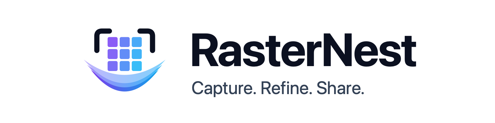

<p align="center">
  <a href="https://rasternest.app">
    <picture>
      <source media="(prefers-color-scheme: dark)" srcset="docs/assets/banner-dark.png">
      
    </picture>
  </a>
</p>

<p align="center">
  <a href="https://rasternest.app"></a>
  
  
  <a href="LICENSE"></a>
  <a href="https://github.com/AMineer/rasternest_app/actions/workflows/ci.yml"></a>
</p>

# RasterNest

**Open-source screen capture and markup.** Grab an area, window or screen with one shortcut, mark it up with arrows, callouts, step numbers and redaction, then copy, drag or export it. Native on macOS, with a scriptable `rnest` CLI for macOS and Linux.

> Status: early (v0.1). macOS app + CLI work today; Linux is CLI-only; Windows is on the roadmap.

## Features

**Capture (⌃⇧C by default)**
- All-in-one: hover to highlight a window and click to capture it; drag to capture an area; Space captures the whole display
- Frozen screen while you select, a pixel magnifier, and live size readout
- Full screen (⌃⇧F), delayed capture (3/5/10 s), and **Grab Text** OCR (⌃⇧T) straight to the clipboard
- Each capture is copied to the clipboard, saved to `~/Pictures/RasterNest`, and opened in the editor (each step can be turned off)

**Markup**
- Arrow, line, rectangle, ellipse, highlighter, text and callouts, numbered steps, pixelate (redact), spotlight, pen, crop
- Single-key tool shortcuts (`A` arrow, `R` rect, `T` text, `N` step, `B` pixelate…), Shift to snap angles/squares
- Per-tool styles (color, width, size, fill, shadow) that stick between captures
- Full undo/redo, nudge with arrow keys, duplicate, and reorder
- Copy (⌘C), drag the image out into any app, export PNG/JPEG (⌘E), or save an editable `.rasternest` file (⌘S)

**CLI: `rnest`**
```sh
rnest capture                       # pick an area or window
rnest capture --region              # drag out an area
rnest capture --window              # click a window
rnest capture --fullscreen -c       # whole display → clipboard
rnest capture --rect 0,0,800,600    # exact rectangle
rnest capture --region --text       # OCR an area, print the text
rnest ocr screenshot.png
rnest export notes.rasternest --format png
rnest displays | rnest windows | rnest backends
```

## Install

**Homebrew (macOS)**: app plus `rnest`:
```sh
brew install --cask amineer/tap/rasternest
```

**Homebrew (Linux or CLI only)**:
```sh
brew install amineer/tap/rnest
```

**Direct download**: grab `RasterNest-x.y.z.dmg` from [Releases](../../releases) and drag it to Applications.

On first capture, macOS asks for **Screen Recording** permission (System Settings › Privacy & Security › Screen & System Audio Recording). When you use `rnest` from a terminal, the permission belongs to that terminal app.

**Linux**: `rnest` uses whichever screenshot tool you have:

| Session | Tools (first found wins) | Extras |
|---|---|---|
| Wayland | `grim` + `slurp`, `gnome-screenshot`, `spectacle` | `wl-clipboard` |
| X11 | `maim` + `slop`, `scrot`, `gnome-screenshot`, `spectacle`, `imagemagick` | `xclip`, `wmctrl` |

OCR on Linux uses `tesseract`. Run `rnest backends` to see what was detected, or force one with `--backend`.

## Build from source

Requires Xcode 16+ (Swift 6) on macOS 14+, or Swift 6 on Linux.

```sh
make test        # unit tests
make run         # build, sign and launch build/RasterNest.app
make cli         # release rnest tarball for this OS
make dmg         # universal app + DMG
make linux-check # build/test the Linux CLI in Docker
```

`scripts/build-app.sh` signs with your first *Developer ID Application* or *Apple Development* identity, falling back to ad-hoc. A stable identity means macOS remembers the Screen Recording permission across rebuilds.

## Automation

The app handles `rasternest://` URLs, so launchers (Raycast, Alfred, Shortcuts) can trigger it:

```sh
open "rasternest://capture"            # all-in-one capture
open "rasternest://capture?delay=5"
open "rasternest://fullscreen"
open "rasternest://text"               # grab text
```

## Docs

- [Architecture](docs/ARCHITECTURE.md): how the package is layered and how to add a platform
- [Distribution](docs/DISTRIBUTION.md): signing, notarization, DMG hosting, Homebrew tap
- [Roadmap](docs/ROADMAP.md): feature parity checklist
- [Brand](docs/BRAND.md): logo, colors and type
- [Contributing](CONTRIBUTING.md)

## License

[MIT](LICENSE)
